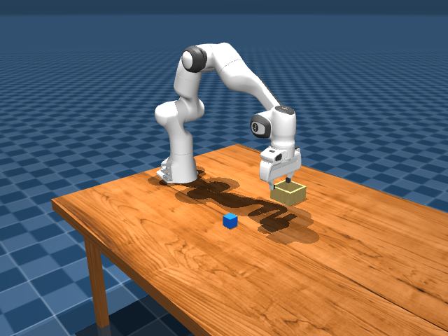
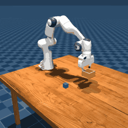
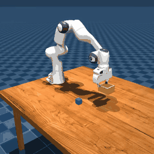
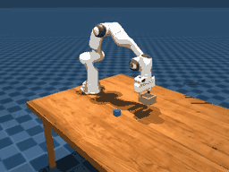
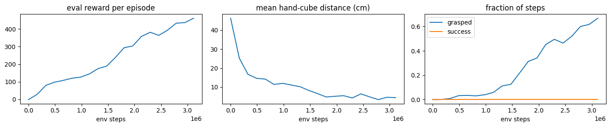

# ML/Sim Onboarding: Harshatha Prasanna

**Summary of onboarding Tasks 1–3: approach, key decisions and results.** The team's original onboarding README is below the line at the bottom.

| Task | Result |
|---|---|
| **1. Scene construction** | ✅ Panda arm, cube, bin and `home` keyframe; verified with a 21-check physics script |
| **2. Imitation learning** | ✅ Expert succeeds **10/10**. The learned policy reaches and grasps the cube but doesn't lift it; causes analysed |
| **3. Reinforcement learning** | ✅ PPO on a Colab GPU (3.1M steps): learned to **reach** (46 → 4.5 cm) and **grasp** (0 → 67% of the time); placing in the bin is the next step |

---

## Task 1: Building the scene

Combined the provided Panda, table and bin files into one MuJoCo scene, added the cube as a free-moving 4 cm box, and defined the `home` pose.

- **Home keyframe includes the cube (16 values).** The cube's free joint adds 7 position values (xyz + a 4-number rotation) on top of the arm's 9.
- **Motor targets (`ctrl`) set in the keyframe.** The arm's position-controlled motors hold the home pose from the first simulation step.
- **Verified with a script** that runs 2 s of physics and checks the arm holds its pose, the cube rests on the table without jitter, everything is within reach, and every name the later tasks rely on exists. 21/21 checks pass.

## Task 2: Imitation learning (copying an expert)

| Expert (10/10 success) | Learned policy (reaches and grasps, doesn't lift) |
|---|---|
|  |  |

**Key decisions:**
- **Expert built with inverse kinematics.** `mplib` isn't available for Apple Silicon or Python 3.13 (Colab's current version), so the expert uses an inverse-kinematics controller with the same straight-line hand motions. This also lets Task 2 run locally.
- **Robot model tuned for grasping:**
  - **Collisions enabled** on the arm's collision meshes, so the fingers can make contact with the cube.
  - **Gripper strength increased** (from about 2 N), so the cube stays in the grip. Solver accuracy, friction and other physics settings were each tested first.

**Results:** trained a behavior-cloning policy on 261 expert demonstrations (65k examples), improving it one measured change at a time:

| Change | Closest approach to cube | Grasped the cube |
|---|---|---|
| Baseline (joint angles + velocities) | 1.6–5.4 cm | 1/5 |
| + hand-to-cube direction as input | 3.4–9.5 cm | 2/5 |
| + predict small joint changes + noisy demonstrations (DART) | **0.3–0.6 cm** | 1/5 |
| + grasp 1 cm higher | 0.6–0.8 cm | **5/5** |

The final policy reaches and grasps but doesn't lift (0/10 full successes). Three causes:
1. **Covariate shift:** the policy only saw perfect demonstrations, so small errors snowball into situations it never saw. Adding noisy demonstrations cut the reaching error from ~4 cm to ~0.5 cm, confirming this was the main problem.
2. **A hidden clock:** the expert switches from "squeeze" to "lift" on a timer the policy can't see. Similar-looking moments map to different correct actions, so the policy averages them and hesitates.
3. **Causal confusion:** adding the policy's own previous command as an input made it *worse* (it learned to repeat itself and drifted away), a known imitation-learning failure. That change was reverted.

## Task 3: Reinforcement learning (learning by trial and error)

  

**Key decisions:**
- **Staged reward:** points for reaching → grasping → lifting → carrying → dropping in the bin. Each stage only pays once the previous one is reached, so pushing the cube along the table doesn't earn carrying points.
- **Success rewarded every step instead of ending the episode.** This keeps finishing the task worth more than hovering near the bin to collect points.
- **Lighter physics for the GPU.** With full arm collisions, the GPU simulator ran ~117× slower. A version where only the fingertips collide keeps training fast, and the expert can still grasp with it.
- **Template and version adjustments:** body positions are read by MuJoCo body index (Brax's state leaves out the world body), and `brax==0.12.5` is used for compatibility with MuJoCo 3.3.4.

**Results** (Colab T4, 1,024 robots training in parallel, ~48 min):

| | Untrained | Trained (3.1M steps) |
|---|---|---|
| Reward per episode | −1.2 | **461** |
| Hand-to-cube distance | 46 cm | **4.5 cm** |
| Time spent grasping the cube | 0% | **67%** |
| Cube in bin | 0% | 0% |

The robot learned in the stages the reward was designed for: reaching first, then grasping, with lifting just beginning. It then settled on grabbing the cube and holding it, a **local optimum**: holding already pays steadily, while lifting doesn't pay enough yet to be worth discovering. All curves were still rising when training stopped. Next steps: train longer and make lifting pay sooner.

---

**More detail:** each task's notebook ends with a full results section; `task*/IMPLEMENTATION.md` has the plan and checks per task; `SUBMISSION.md` lists every change to the provided files; `PROGRESS.md` is the full log.

---
---

# Simulation Onboarding Tasks

**Welcome to Triton Droids! 🎉**

This guide will introduce you to MuJoCo through key fundamentals of robotics and machine learning techniques for robotic systems. Each task is designed to expose you to the physics engine and different aspects of robot behavior. You will gain the skills to effectively use MuJoCo as a simulation platform, while also exploring new approaches and solutions to robotic challenges.

Follow the steps, and don’t hesitate to experiment or ask questions as you go!

## General Tips
- **Get started with the official [MuJoCo tutorial](https://colab.research.google.com/github/google-deepmind/mujoco/blob/main/python/tutorial.ipynb) first.**
- USEFUL RESOURCES: [MuJoCo API Reference](https://mujoco.readthedocs.io/en/stable/APIreference/index.html), [MJCF (MuJoCo XML) Reference](https://mujoco.readthedocs.io/en/stable/XMLreference.html)
 
## Learning Objectives
The goal of this guide is to introduce you to **MuJoCo** and **MJX** by constructing and controlling simulated environments. You will learn how machine learning techniques like imitation learning and reinforcement learning translate to robot control, and gain hands-on experience with the relevant technologies and frameworks.

Through these tasks, you should become comfortable navigating and manipulating MuJoCo environments but also understand how to design, train, and deploy learning-based policies.

Let's build the foundation to create a humanoid robot!

**Good luck, and have fun!**

## Getting Started
- To get started read [`setup.md`](docs/setup.md) to set up your environment.
- Then, complete the tasks in order:  
  1. [`task1`](task1/) → Scene Construction
  2. [`task2`](task2/) → Imitation Learning   
  3. [`task3`](task3/) → Reinforcement Learning   
- Each task folder includes extra implementation guidance in `tips.md`.
  

  >NOTE: task 0 is there to help you gain a better understanding of xml structure and kinematic tree, but is not necessary to complete the other tasks. 

## Additional Resources
- [Open AI Spinning Up](https://spinningup.openai.com/en/latest/) - Deep dive into deep reinforcement learning and core algorithms / derivations

- [MuJoCo Playground](https://playground.mujoco.org/) - Examples of successfully trained policies using reinforcement learning for locomotion and manipulation with MJX 

